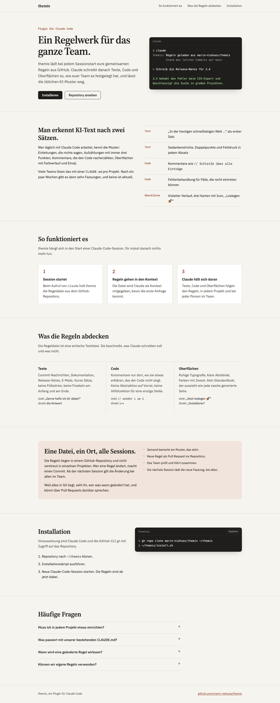
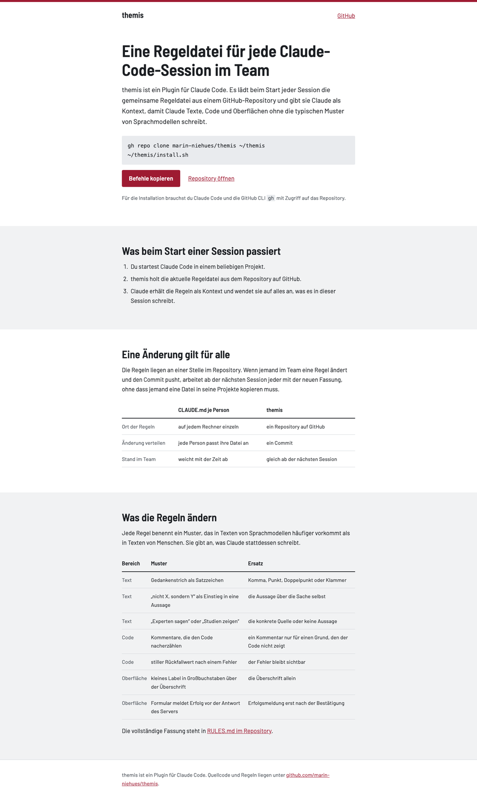

# themis

Gemeinsame Schreib- und Arbeitsregeln für Claude Code, als Plugin.

Die Regeln stehen in `RULES.md` und werden bei jedem Start einer Session aktuell aus diesem Repo geholt. Sie liegen nicht dauerhaft auf deinem Rechner. Ändert sich die Datei, gilt die neue Fassung ab deiner nächsten Session.

## Vergleich

Beide Seiten hat Claude Opus 5.5 am 20. November 2026 mit derselben Aufgabe gebaut: eine Landingpage für themis als einzelne HTML-Datei. Für die rechte Seite hat Claude vorher `RULES.md` gelesen. Jede Seite ist ein einzelner Durchlauf.

<table>
<tr><th>Ohne themis</th><th>Mit themis</th></tr>
<tr>
<td valign="top"></td>
<td valign="top"></td>
</tr>
</table>

Die linke Seite zeigt die Muster, die Anti-Slop-Kataloge 2026 als zweite Welle beschreiben: cremefarbener Hintergrund mit Serifenschrift und Terrakotta, ein Label in Monospace über der Überschrift, ein nachgebautes Terminal mit erfundener Ausgabe und drei nummerierte Karten. Die rechte Seite leitet Farbe und Schrift aus dem Bild einer Loseblattsammlung ab, hat eine Hauptaktion und stellt Vergleiche als Tabelle dar. Die HTML-Dateien liegen in `docs/vergleich`.

## Installation

Voraussetzungen: Claude Code, GitHub CLI (`gh`) angemeldet, Lesezugriff auf dieses Repo, `python3`.

```bash
gh repo clone marin-niehues/themis ~/themis
```

```bash
~/themis/install.sh
```

Das Skript trägt themis in `~/.claude/settings.json` ein und legt vorher eine Sicherungskopie der Datei an. Danach eine neue Session starten, die Regeln sind drin.

Der Ordner `~/themis` muss liegen bleiben. Ein `git pull` ist für neue Regeln nicht nötig, weil sie bei jedem Start aus dem Repo geholt werden.

## Verhalten

| Zustand | Verhalten |
|---|---|
| RULES.md erreichbar | Regeln gelten, Kopie im Cache |
| RULES.md leer, gelöscht, Repo weg oder kein Zugriff | Keine Regeln, Cache wird gelöscht |
| Kein Netz | Letzter Stand aus dem Cache |
| gh nicht angemeldet | Letzter Stand aus dem Cache, Hinweis in stderr |

Cache: `~/.cache/themis/rules.md`

## Deinstallation

```bash
~/themis/uninstall.sh
```

```bash
rm -rf ~/themis
```

Danach ist nichts mehr da.

## Für den Betreiber

Die Herleitung der Regeln mit Quellen steht in `docs/katalog.md`.


- **Regeln ändern:** `RULES.md` bearbeiten und auf `main` pushen. Gilt ab der nächsten Session aller Nutzer. Kein Versionsbump nötig.
- **Regeln abschalten:** `RULES.md` leeren oder löschen. Oder das Repo privat halten und einzelnen Personen den Zugriff entziehen.
- **Skripte ändern:** pushen. Nutzer bekommen die Änderung mit `git pull` in ihrem Ordner.
- **Alternative über das Plugin-System:** Das Repo lässt sich auch mit `/plugin marketplace add marin-niehues/themis` und `/plugin install themis@niehues` einbinden. Nur einen der beiden Wege nutzen, sonst werden die Regeln doppelt geladen.
- **Abruf von Hand prüfen:**

```
bash themis/scripts/fetch-rules.sh
```
