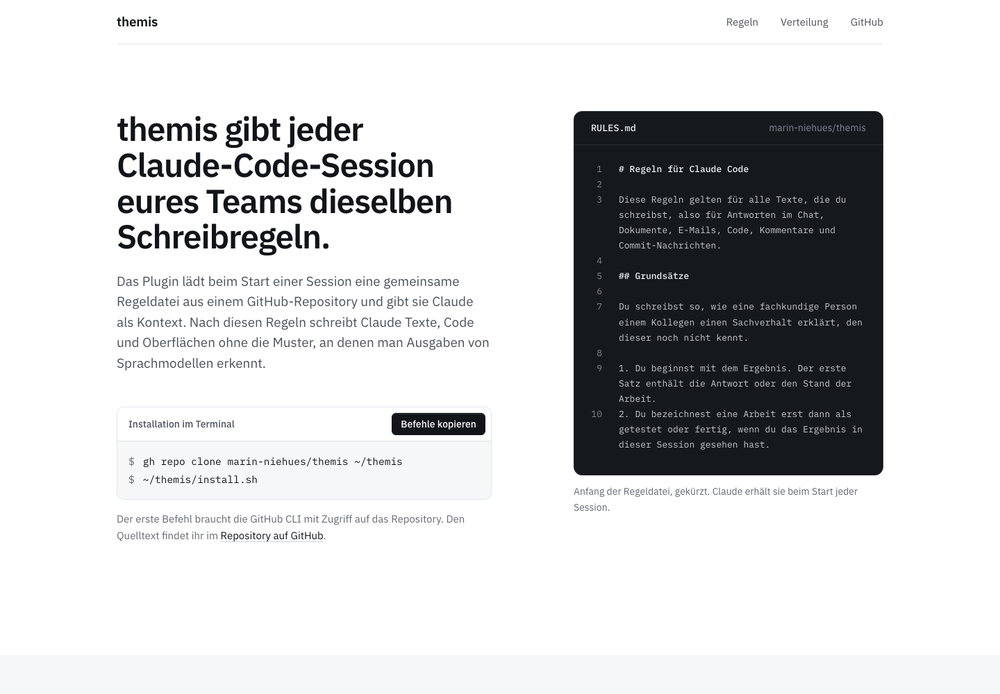

# themis

themis gibt Claude Code bei jedem Start einer Session gemeinsame Regeln für Texte, Code und Oberflächen mit. Die Regeln stehen in `RULES.md` in diesem Repo. Das Skript holt die Datei bei jedem Start aktuell von GitHub, sodass sie nicht dauerhaft auf deinem Rechner liegt. Wenn sich die Datei ändert, gilt die neue Fassung ab deiner nächsten Session.

## Vergleich

<table>
<tr><th>Ohne themis</th><th>Mit themis</th></tr>
<tr>
<td valign="top"><a href="docs/vergleich/anschauung/ohne-themis-ganz.jpg"></a></td>
<td valign="top"><a href="docs/vergleich/anschauung/mit-themis-ganz.jpg"></a></td>
</tr>
</table>

Die linke Seite ist ein gestelltes Anschauungsbeispiel, für das Claude absichtlich jedes Muster eingebaut hat, das `RULES.md` ausschließt. Die rechte Seite hat Claude nach `RULES.md` gebaut. Ein Klick auf ein Bild öffnet die ganze Seite. Einen echten Durchlauf derselben Aufgabe ohne Inszenierung zeigt der Ordner `docs/vergleich`.

## Installation

Du brauchst Claude Code, `python3` und die GitHub CLI `gh`, bei der du angemeldet bist. Mit diesen beiden Befehlen klonst du das Repo und trägst themis ein:

```bash
gh repo clone marin-niehues/themis ~/themis
```

```bash
~/themis/install.sh
```

Das Skript trägt themis in `~/.claude/settings.json` ein und legt vorher eine Sicherungskopie dieser Datei an. Die Regeln gelten ab der nächsten Session, die du startest.

Der Ordner `~/themis` muss auf deinem Rechner bleiben, weil das Skript darin liegt. Du musst für neue Regeln kein `git pull` ausführen, weil das Skript die Regeln bei jedem Start von GitHub holt.

## Verhalten

| Zustand beim Start | Ergebnis |
|---|---|
| `RULES.md` ist erreichbar | Die Regeln gelten. Das Skript speichert eine Kopie im Cache. |
| `RULES.md` ist leer oder gelöscht, das Repo fehlt oder du hast keinen Zugriff | Es gelten keine Regeln. Das Skript löscht den Cache. |
| Der Rechner ist offline | Die Kopie aus dem Cache gilt. |
| `gh` ist nicht angemeldet | Die Kopie aus dem Cache gilt. Das Skript gibt einen Hinweis aus. |

Der Cache liegt unter `~/.cache/themis/rules.md`.

## Deinstallation

Das erste Skript entfernt den Eintrag aus den Einstellungen und löscht den Cache. Der zweite Befehl löscht den Ordner mit dem Repo.

```bash
~/themis/uninstall.sh
```

```bash
rm -rf ~/themis
```

Danach liegt nichts mehr von themis auf deinem Rechner.

## Für den Betreiber

Du änderst die Regeln, indem du `RULES.md` bearbeitest und auf `main` pushst. Die Änderung gilt ab der nächsten Session aller Nutzer, ohne dass du eine Version erhöhen musst. Wenn du die Regeln für alle abschalten willst, leerst oder löschst du `RULES.md`.

Änderungen an den Skripten erreichen die Nutzer erst, wenn sie in ihrem Ordner `git pull` ausführen.

Das Repo lässt sich auch über das Plugin-System von Claude Code einbinden. Ein Nutzer verwendet dafür die Befehle `/plugin marketplace add marin-niehues/themis` und `/plugin install themis@niehues`. Er nutzt nur einen der beiden Wege, weil Claude die Regeln sonst doppelt lädt.

Mit diesem Befehl prüfst du von Hand, was das Skript beim Start ausgibt:

```bash
bash themis/scripts/fetch-rules.sh
```

Die Herleitung der Regeln mit Quellen steht in `docs/katalog.md`. Die Recherche zu visuellen Erkennungszeichen steht in `docs/reports`.
